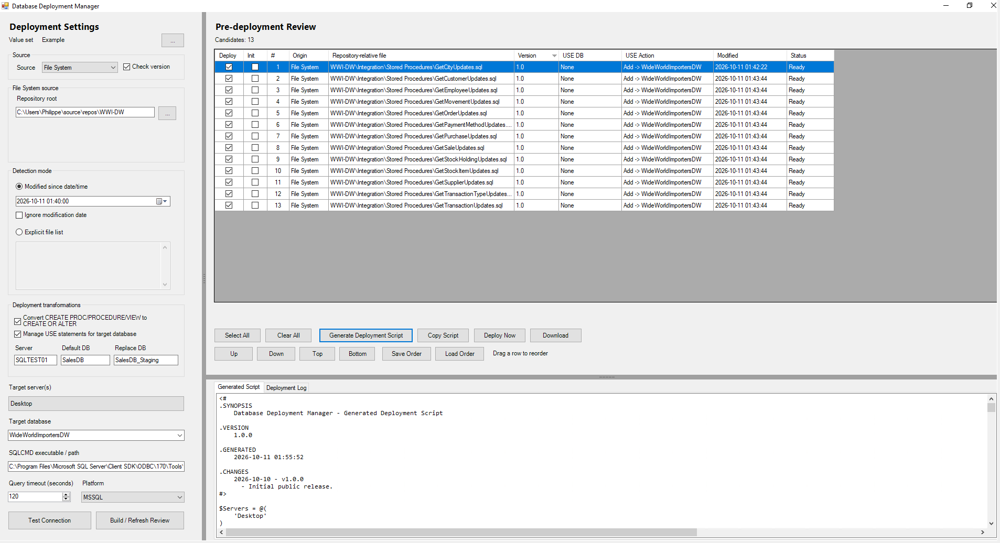

# Database Deployment Manager

A Windows desktop tool for deploying SQL scripts to your database servers
safely and repeatably. Point it at a folder of SQL files (or an S3 bucket),
review what will run, and deploy to one or many SQL Server instances, with the
steps and settings you used last time already filled in.

Written in PowerShell. No installer, no database of its own, nothing to host:
fork it, add your servers, and run it.

## Connects to

| Target | Sign-in |
|---|---|
| **SQL Server** (local, network, named instances) | **Windows integrated security**, using the account running the tool |
| **SQL Server** (local, network, named instances) | **SQL login** - the password is asked once per session and never stored |
| **Microsoft Fabric** warehouses | **Microsoft Entra ID** - browser sign-in, or a one-time Azure CLI sign-in with no prompts during the deployment |
| **Azure SQL** | Microsoft Entra ID (same sign-in as Fabric; not yet tested) |

The sign-in method is chosen per value set, so one tool can deploy to a local
server with a SQL login and to a Fabric warehouse with Entra ID, switching in
one click.

- **Author:** Philippe Addelia
- **Version:** 1.2.0
- **License:** MIT (see [LICENSE](LICENSE))

## What it does

Deploying a handful of changed scripts by hand is easy to get wrong: wrong
server, wrong database, wrong order, a script left out. Database Deployment
Manager puts a review step in front of the deployment:

1. **Find** the scripts to deploy, either everything changed since a date and
   time or an explicit list of files.
2. **Review** them in a grid. Exclude items, mark initialization scripts, and
   put the rest in the right order.
3. **Deploy** to the selected servers and database, or generate a standalone
   PowerShell script to run later or hand to someone else.
4. **Fix and retry.** If some items fail, the rest still deploy and only the
   failures stay selected, with the error details ready to copy.

## Highlights

- **Your own lists.** Define named sets of servers and databases (for example
  dev, test, staging, a second customer) and switch between them in one click.
- **Remembers your last session.** Servers, database, folders, options and
  window layout come back the next time you open it.
- **Safe by design.** Source files are never modified; every change is made to
  a temporary copy, and a pre-deployment review shows what will happen.
- **Script preparation.** Optional conversion to `CREATE OR ALTER`, control of
  which database each script runs against, and protection for the
  `ANSI_NULLS` / `QUOTED_IDENTIFIER` settings.
- **Local SQL Server and Fabric.** Windows integrated security or a SQL login
  for SQL Server; Microsoft Entra ID for Microsoft Fabric warehouses and Azure
  SQL. Each value set can also use its own `sqlcmd.exe`.
- **Build lists in the GUI.** Create and edit value sets (servers, databases,
  sign-in method) from a dialog, with no config editing and no restart.
- **Files or S3.** Deploy from a local repository folder or from an AWS S3
  bucket.
- **Repeatable.** Save and reload a deployment order, or generate a portable
  deployment script.
- **Extensible.** Engines are organized by platform; SQL Server is implemented
  today.

## Screenshot



*The main window deploying Microsoft's WideWorldImporters sample stored
procedures: settings on the left, the pre-deployment review grid on the right,
and the generated script and deployment log below.*

## Requirements

- Windows PowerShell 5.1 or later
- `sqlcmd.exe` (SQL Server command-line tools). Microsoft Fabric with Entra
  ID works best with the newer Go-based sqlcmd
- Network access from your machine to the target servers
- Azure CLI, optional: lets Fabric deployments sign in once instead of per file
- AWS CLI, only if you deploy from S3

## Quick start

1. Fork and clone this repository, or download it as a ZIP.
2. Run:

   ```powershell
   powershell.exe -ExecutionPolicy Bypass -File ".\Database Deployment Manager.ps1"
   ```

   If Windows blocked the downloaded files, run
   `Get-ChildItem -Recurse | Unblock-File` first.
3. On first launch the tool creates your personal config from the shipped
   example. Click **...** next to **Value set**, choose
   **New / edit value set...**, enter your servers and databases, choose the
   sign-in method (Windows, SQL login or Microsoft Entra) and save. The set is
   available immediately.
4. Click **Test Connection** before you deploy anything.

Your personal config and saved value sets are excluded from git, so pulling
updates from this repository never overwrites them. The
[Usage Guide](docs/USAGE.md) has step-by-step installation, every setting and
worked examples for local SQL Server and Microsoft Fabric.

> **Test first.** This tool runs SQL against the servers you select. Try it on
> a non-production server before using it on anything important. It is
> provided as is, without warranty.

## Documentation

See the [Usage Guide](docs/USAGE.md) for installation, key terms, configuration,
sign-in methods (Windows, SQL login, Microsoft Entra / Fabric), the explicit
file list format, deployment options, remembered settings and troubleshooting.

## Project layout

```text
Database Deployment Manager.ps1                 the application
Config/                                         example config (your own copy is git-ignored)
Modules/Platforms/MSSQL/                        SQL Server deployment engine
docs/                                           usage guide (and screenshots)
```

## Contributing

Issues and pull requests are welcome. Please keep example values generic and do
not commit real server names, paths or credentials.
